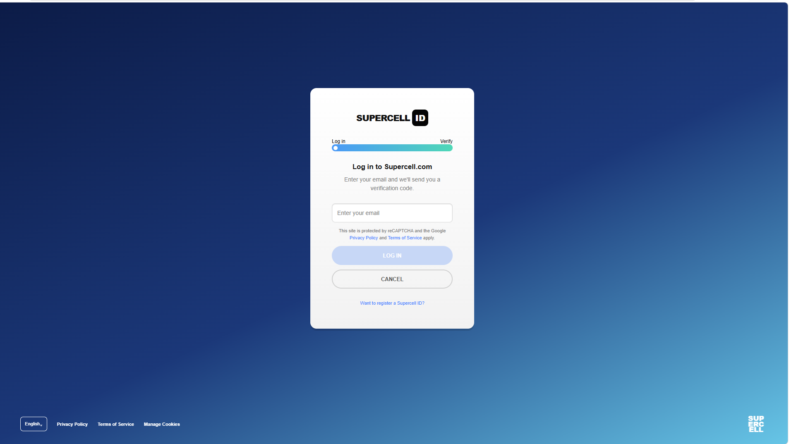
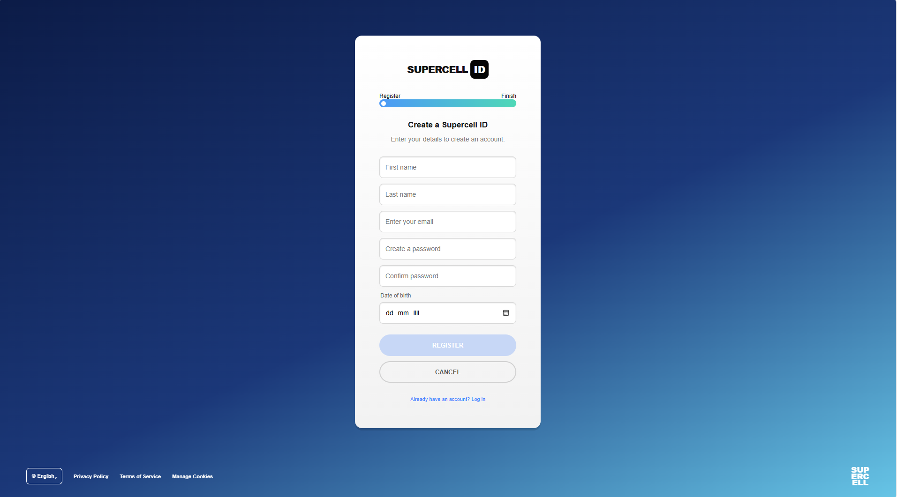

# Supercell ID – Prijavna stran

## O projektu

Ta projekt je šolska naloga, pri kateri sem izdelal spletno stran po vzoru prijavne strani Supercell ID.

Spletna stran omogoča prikaz prijavnega obrazca, registracijskega obrazca in dveh strani za uspešen zaključek postopka.

Projekt je izdelan z **HTML in CSS**.

## Funkcionalnosti

- Prijavna stran z vnosom e-pošte.
- Registracijska stran z imenom, priimkom, e-pošto, geslom in potrditvijo gesla.
- Vnos datuma rojstva pri registraciji.
- Sprememba barve gumba, ko so obvezna polja pravilno izpolnjena.
- Ločena stran za uspešno prijavo.
- Ločena stran za uspešno registracijo.
- Modro ozadje, bela kartica in zaobljeni gumbi po vzoru Supercell ID.

## Uporabljene tehnologije

- **HTML5** – za strukturo spletne strani in obrazce.
- **CSS3** – za oblikovanje, barve, postavitev in učinke.

## Datoteke projekta

- `login.html` – stran za prijavo.
- `register.html` – stran za registracijo.
- `login-success.html` – stran po uspešni predstavitveni prijavi.
- `register-success.html` – stran po uspešni predstavitveni registraciji.
- `style.css` – skupna CSS-pravila za oblikovanje strani.

## Posnetki zaslona

Spodaj sta vključena oba posnetka zaslona iz repozitorija:

## Kako zaženem projekt?

1. Prenesem ali kloniram repozitorij.
2. Vse datoteke shranim v isto mapo.
3. Odprem datoteko `login.html` v spletnem brskalniku.
4. Prek povezav preizkusim prijavo in registracijo.

## Kaj sem se naučil?

Pri projektu sem se naučil uporabljati HTML za izdelavo obrazcev in povezav ter CSS za oblikovanje spletne strani. Spoznal sem tudi uporabo razredov, ID-jev, psevdorazredov in osnovnega preverjanja v[...] 

## Omejitve projekta

To je demonstracijski projekt. Ne uporablja strežnika ali podatkovne baze, zato ne shranjuje uporabniških računov in ne preverja dejanske prijave. Preverjanje polj izvaja brskalnik s pomočjo osnov[...]

## Avtor

Šolski projekt – izdelava prijavne in registracijske strani.
